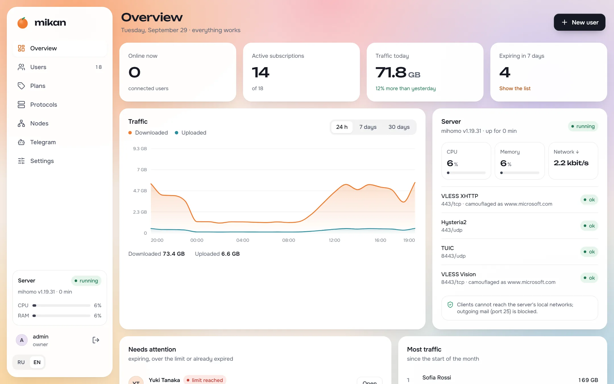
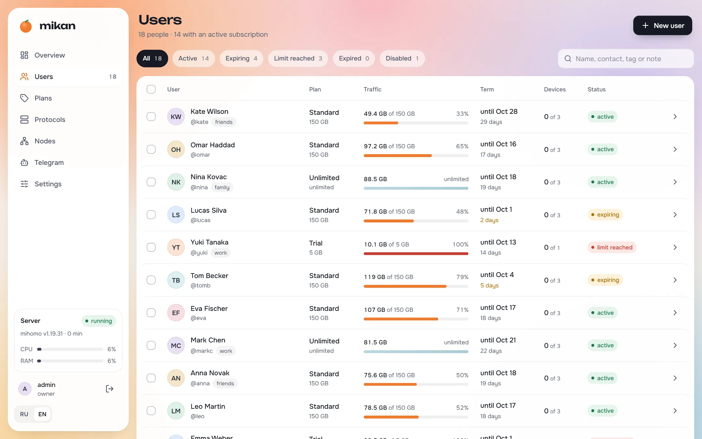
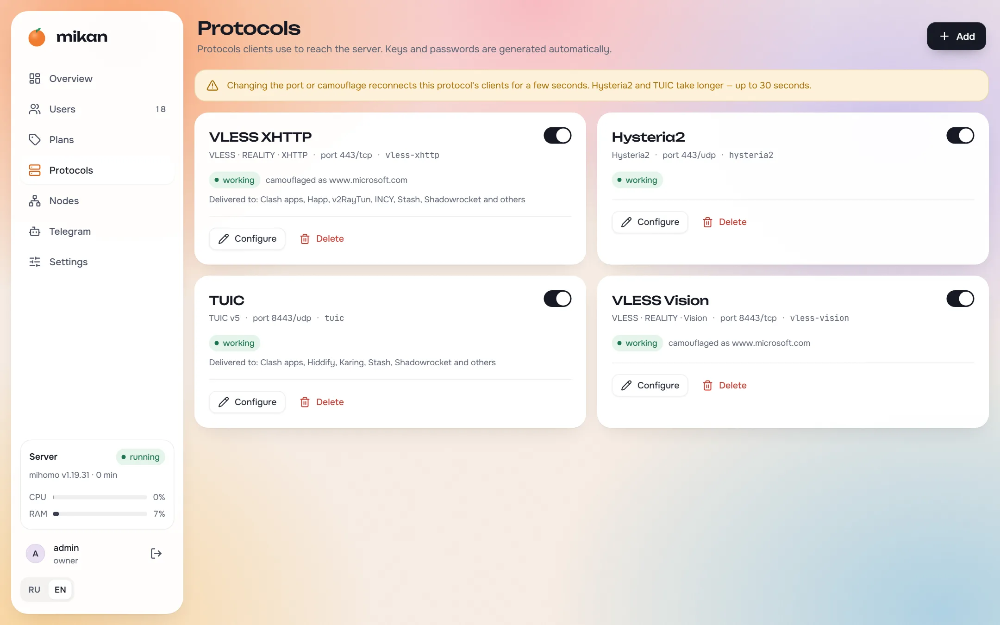
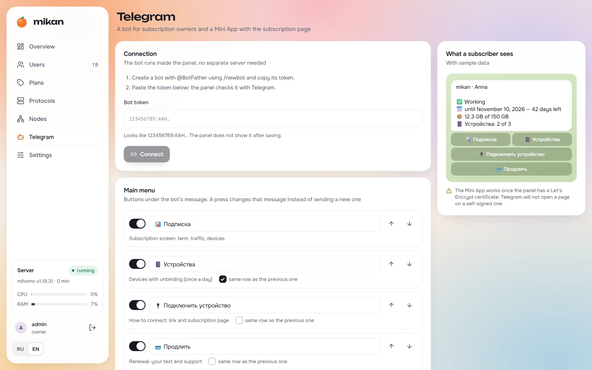

# AoiVPN

**AoiVPN** — VPN-панель сервиса [AoiVPN](https://aoimusic.ru), форк
[Miroshka000/mikan](https://github.com/Miroshka000/mikan) (GPL-3.0, см.
[LICENSE](LICENSE)). Апстрим — канонический проект, всё признание ему; форк живёт
под собственным именем **AoiVPN** (имя и логотип mikan не входят в GPL-лицензию —
[TRADEMARK.md](TRADEMARK.md) апстрима это прямо требует).

Код — GPL-3.0 с дополнительными условиями [NOTICE.md](NOTICE.md); атрибуция
апстриму сохранена. Встроенный логотип/название апстрима в UI заменены на бренд
AoiVPN (сайдбар, экран входа, favicon, `<title>`), технические идентификаторы
(`mikan` в CLI-командах, конфигах и localStorage) не переименовывались.

---

## Что изменено относительно апстрима

### Подписка (главное)

Контракт с клиентами AoiVPN — **ровно две select-группы**, всегда:

```yaml
proxy-groups:
  - name: AoiVPN            # только прокси нод (плоский список) + последним членом ссылка на bypass-группу
    type: select
  - name: "🇷🇺 Обход БС"     # select из внешних bypass-прокси (sub_bypass); нет, если bypass пуст
```

- В главной группе **нет bypass-прокси поимённо** — только ноды + одна ссылка на
  «🇷🇺 Обход БС» (их сотни, они тонули бы среди нод). Сами bypass-прокси лежат в
  общем `proxies` и в своей группе. Fix в 0.5.1.2: до этого обход-прокси попадали
  в главную группу поимённо.
- Никаких url-test «Авто», групп по странам, скрытого алиаса `PROXY` или
  per-service групп — что бы ни стояло в настройках роутинга (контролы скрыты в UI).
- DNS DoH-серверы идут с суффиксом **реального имени главной группы**
  (`#AoiVPN`), а не константы `PROXY` — иначе DNS резолвится с устройства и
  утекает регион.
- Внешние bypass-прокси задаются настройкой `sub_bypass` (JSON `{group, proxies[]}`),
  панелью не трекаются; имя/иконка главной группы — `sub_group_main`/`sub_group_icon`;
  порядок нод/протоколов — `sub_sort`.
- DNS-тюнинг клиента: `respect-rules` + `prefer-h3` вместо sniffer,
  `fake-ip-filter` (Roblox и приложения вне туннеля), `find-process-mode: always`
  (PROCESS-NAME,DIRECT для игр).
- hysteria2: в клиентский конфиг эмитятся `up`/`down`.
- Content-Disposition inline, filename = имя группы.

### Протоколы

- В клиентские reality-ссылки добавляется `support-x25519mlkem768: true`
  (xray ≥ 26.9.8 требует post-quantum keyshare; подлежит переносу из ветки
  `aoi-0.5.0.4`).
- hysteria2 `up/down` в клиентском конфиге (mihomo без них гоняет BBR-автопробинг).

### Панель

- Брендинг AoiVPN: логотип, favicon, `<title>`, текст в сайдбаре/логине; версия
  форка в сайдбаре («AoiVPN · mikan fork X» — упоминание апстрима разрешено
  TRADEMARK.md).
- В списке People — Telegram-identity и состояние `no_subscription`
  (`NULL expires_at` = «без подписки»).
- Скрытые блоки UI («Выбор сервера» на странице роутинга).

### Инфраструктура

- `.github/workflows/aoi-image.yml` — единственный CI форка: lean amd64-образ →
  `ghcr.io/akimiska/mikan:{latest,VERSION,sha}`. Версия форка — `FORK_VERSION`
  в этом workflow.
- Апстримный `ci.yml` на push в main не бегает — тесты гоняются локально.

## Деплой

**Только вручную, docker compose, образ пиннится тегом:**

```bash
cd /opt/mikan && MIKAN_IMAGE=ghcr.io/akimiska/mikan:<tag> docker compose pull && docker compose up -d
```

> [!CAUTION]
> **Не обновляйте этот форк кнопкой «Обновить» в панели и не включайте автообновление.**
> Host-updater тянет подписанный индекс **апстрима** (`installer/src/release.rs`:
> REPO и PUBLIC_KEY захардкожены) — обновление заменит форк чистым mikan.
> В проде: `policy.json {"auto": false}`, `nodes_follow_panel=false`.

## Тесты и сборка

Как в апстриме (см. апстримный README ниже по языковым ссылкам), плюс:
`CGO_ENABLED=0 go test ./internal/panel/subs/` — golden-тесты раскладки подписки
(`internal/panel/subs/testdata/golden/`). Правила работы агентов с форком —
[AGENT.md](AGENT.md).

## License

[GNU GPL v3](LICENSE) с дополнительными условиями [NOTICE.md](NOTICE.md).
Имя «mikan», логотип и маскот апстриму не принадлежат по GPL — см.
[TRADEMARK.md](TRADEMARK.md), поэтому этот форк называется AoiVPN. Встроенный
mihomo — GPL-3.0.

---

## Upstream documentation

Everything below is upstream's README. The original one-command install flow, the
installer and the signed release manifests belong to upstream and are **not** how this
fork is built or deployed.

<div align="center">

<picture>
  <source media="(prefers-color-scheme: dark)" srcset=".github/assets/banner-en-dark.svg">
  
</picture>

<br>

**A fast, beautiful VPN panel on the [mihomo](https://github.com/MetaCubeX/mihomo) core — one command to install, nothing to babysit.**

[](https://miroshka000.github.io/mikan/)
[](https://github.com/Miroshka000/mikan/releases)
[](https://github.com/Miroshka000/mikan/pkgs/container/mikan)
[](LICENSE)
[](https://t.me/mikanvpn)

**English** · [Русский](README.ru.md) · [简体中文](README.zh-CN.md) · [فارسی](README.fa.md) · [Türkçe](README.tr.md) · [Español](README.es.md)

</div>

---

### Install

On a fresh Ubuntu 22.04+ or Debian 12+ server (amd64 or arm64):

```bash
curl -fsSL https://github.com/Miroshka000/mikan/releases/latest/download/install.sh | sudo bash
```

The installer asks for the panel language and an optional domain, checks that the domain points to the server, installs Docker if needed, picks REALITY camouflage sites next to your server and prints your admin link. Run `mikan` again at any time for the management menu.

A node for an existing panel: the panel's **Nodes** page (or `mikan node add`) gives the command with its key:

```bash
curl -fsSL https://github.com/Miroshka000/mikan/releases/latest/download/install.sh | sudo bash -s -- --join KEY
```

Without questions, for scripts: `… | sudo bash -s -- --yes --lang en --domain vpn.example.com --email you@example.com` (all flags: `mikan install --help`).

### Why mikan

<table>
<tr>
<td width="50%" valign="top">

### 🛡️ Survives blocking on its own
mikan watches whether real clients still reach each protocol. When a port gets blocked on the way, it moves the protocol to a free HTTPS port; when a REALITY camouflage site stops working, it picks a new one next to your server.

</td>
<td width="50%" valign="top">

### 📱 Every app gets what it can use
Subscriptions detect the app — Happ, v2RayTun, Koala Clash, SlothClash, Clash Verge, FlClash, ClashFest, Hiddify, Shadowrocket and more — and hand it only the protocols it actually supports. No more “it doesn't work for me”.

</td>
</tr>
<tr>
<td valign="top">

### 📊 Byte-exact accounting
mihomo is embedded as a library, so traffic is counted per user on every connection — not sampled. Plans by time and gigabytes, billing days, device limits and device binding against key sharing. Since every connection is known by its user, the torrent blocker bans the one who torrents on every node, not a shared IP.

</td>
<td valign="top">

### 🤖 Telegram bot and Mini App built in
Subscribers check their plan, devices and connection guides in a bot you set up in the panel, open the subscription page as a Telegram Mini App and get notified before it expires. They can also buy and renew — Telegram Stars, cards and SBP through YooKassa, or crypto through CryptoBot — and the panel hands out the link by itself. Broadcasts respect Telegram's limits.

</td>
</tr>
<tr>
<td valign="top">

### 🪶 Light as a mandarin
Go and PostgreSQL, three small containers. On a working server with clients: **~14 MB RAM** for the panel, **~50 MB** for the database, **~40 MB** for the VPN core.

</td>
<td valign="top">

### 🔒 Locked down by default
Secret admin link on a random port, HTTPS with Let's Encrypt (even for a bare IP), argon2id, TOTP 2FA, CSRF protection, strict CSP, audit log. Containers run non-root, read-only, with all capabilities dropped.

</td>
</tr>
<tr>
<td valign="top">

### 🌐 WARP and server cascades
Each node can have its own WARP — registered in one click or from your WireGuard config — and protocols can leave through another node of the panel (client → node A → node B → internet). Chosen protocols, domains and networks take those ways out, everything else goes direct.

</td>
<td valign="top">

### 🧩 API and keys for integrations
A REST API documented right in the panel, with read-only or full-access keys for bots, billing and monitoring.

</td>
</tr>
</table>

### Screenshots

<table>
<tr>
<td width="50%"></td>
<td width="50%"></td>
</tr>
<tr>
<td></td>
<td></td>
</tr>
</table>

### Managing the server

Run `mikan` for the menu, or use the commands directly:

| Command | What it does |
|---|---|
| `mikan status` | containers, versions, health, available update |
| `mikan logs [panel\|node]` | live logs |
| `mikan url` | admin link |
| `mikan reset-password` · `reset-path` · `disable-2fa` | regain access |
| `mikan update` | update now (backup first, automatic rollback) |
| `mikan backup` · `restore FILE` | backups in `/opt/mikan/backups` |
| `mikan node …` · `mikan inbound …` | nodes and protocols |
| `mikan targets scan` · `apply` | REALITY camouflage sites next to the server |
| `mikan join KEY` | on a node: take a new key from the panel |
| `mikan restart` | restart the containers |
| `mikan doctor` | check the server: Docker, ports, firewall, clock, DNS, disk |
| `mikan support CODE` | send diagnostics to a support ticket when the panel is down |
| `mikan support-access on\|off` | allow or forbid support access on this server |
| `mikan api-lockdown [status\|off]` | on a node: the state of the "node API from the panel's IP only" rule, or lift it at once |
| `mikan uninstall` | stop and remove the command, keep the data |

### License (upstream)

mikan is free software under the [GNU GPL v3](LICENSE) with the additional terms in [NOTICE.md](NOTICE.md): keep the attribution, do not pass a modified version off as the original, no rights to the name and the logo. Copyright (C) 2026 Miroshka and Mikan. It embeds [mihomo](https://github.com/MetaCubeX/mihomo) (GPL-3.0) and adapts parts of [3x-ui](https://github.com/MHSanaei/3x-ui) (GPL-3.0). Fonts: Unbounded, Onest, JetBrains Mono (SIL OFL 1.1).
